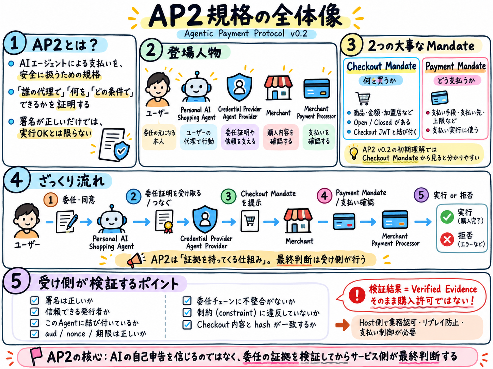

# AP2 Mandate Verifier for Ruby

> **Status: research/design only.** P1-7 documented Host trust anchors, evidence vs authorization, atomic nonce/replay, clock/revocation, and signed Receipt responsibilities with **34 planned Host test cases (NOT run)**. P1-6's historical synthetic signed probes remain **17 GREEN / 0 RED / 0 ERROR / 1 Host replay boundary**, plus **43/43 regressions**. **No generic Ruby Gem/API**; implementation **HOLD**, RubyGems release and production/real payments **NO-GO**.
>
> Independent, unofficial Ruby OSS exploration. Not affiliated with Google, the AP2 project, or FIDO Alliance.

## AP2を図で理解する / Visual guides

手書きの学習用図解です。概念を理解するための資料であり、仕様の正式な要件は [AP2 v0.2 仕様基準点](docs/SPEC_BASELINE.md) を参照してください。

**まずは全体像**

- [① AP2規格の全体像](docs/assets/ap2-overview.png)
- [② AP2の委任フローと信頼検証](docs/assets/ap2-delegation-trust-flow.png)

**次に内部構造と安全性**

- [③ Mandateの内部構造](docs/assets/mandate-anatomy.png)
- [④ SD-JWTと委任チェーンの仕組み](docs/assets/sd-jwt-delegation-chain.png)
- [⑤ 攻撃パターンとFail Closed](docs/assets/attack-patterns-fail-closed.png)



## Why?

A future personal AI could arrive at a web service carrying evidence of authority granted by a person, without that person pre-configuring every service. **A self-declared permission is not proof of authority.** The service needs verifiable evidence, an explicit trust policy, and its own final authorization decision.

This project explores **AP2 v0.2 Checkout Mandate verification in Ruby**, initially on the merchant/verifier side, to see whether a small reusable Ruby Gem is justified.

```text
Human user -- trusted consent/mandate --> Personal AI
                                            |
                                            | presents external mandate
                                            v
                                        Ruby service
                                            |
                                [AP2 Mandate Verifier]
                                            |
                         verified evidence / verification failure
                                            |
                         Service's own authorization and controls
                                            |
                                   Business action or STOP
```

A valid digital signature does **not** by itself establish that this Agent is authorized for this specific user, operation, merchant, price, or moment.

## Proposed initial scope

- Study AP2 **v0.2** Agent Authorization and Checkout Mandate; do not mix in the earlier v0.1 model.
- Explore cryptographic verification, trusted issuer/keys, holder/Agent binding, transaction binding, Open/Closed mandate constraints, audience, time, and failure cases.
- Compare behavior and test vectors with the official AP2 Python implementation before claiming interoperability.
- Expose verified evidence to the **host**; do not replace the host's authorization or payment controls.
- Start with a design and security review. No Gem implementation has been approved yet.

## Explicit non-goals

- Building a wallet, user credential issuer, payment processor, trusted consent UI, Personal AI, MCP server, or A2A transport.
- Supporting all AP2 flows or production payments in the first iteration.
- Assuming all unknown issuers or self-asserted permissions are trustworthy.
- Changing ActingFor Core, ActingFor Shopping Demo or a2a-rails.

## Research documentation

- [Project scope and design decisions — Japanese](docs/PROJECT.md)
- [Official AP2 sources and standards watchlist](docs/OFFICIAL_SOURCES.md)
- [AP2 v0.2 frozen specification and Python SDK baseline](docs/SPEC_BASELINE.md)
- [AP2 Checkout Mandate verifier requirements and trust boundaries (P0-2)](docs/VERIFIER_REQUIREMENTS.md)
- [Official Python SDK and Ruby ecosystem research (P0-3)](docs/ECOSYSTEM_RESEARCH.md)
- [Minimal Checkout Verifier public API proposal — design only (P0-4)](docs/API_PROPOSAL.md)
- [Phase 0 research decision — initial HOLD, **P0-5b CONDITIONAL GO for a narrow offline PoC only**](docs/RESEARCH_DECISION.md)
- [Python baseline verification — P0-5a: official pytest 186 PASS / 2 FAIL, signed negative probes 12 PASS (plus earlier isolated 11 PASS)](docs/PYTHON_BASELINE_VERIFICATION.md)
- [Minimal Fail Closed Profile — strict two-hop autonomous Checkout and Host trust gates (P0-5b)](docs/FAIL_CLOSED_PROFILE.md)
- [Ruby interoperability feasibility — P1-0 ES256/JWK + Checkout Hash + official schema: 14 PASS](docs/RUBY_FEASIBILITY_SPIKE.md)
- [Ruby SD-JWT Root & Disclosure — P1-1 pinned Python SDK issuance, hidden constraint fail closed: 10 PASS](docs/RUBY_SDJWT_RESEARCH.md)
- [Ruby two-hop delegation — P1-2 pinned Python signed Open→Closed, cnf/sd_hash/aud/nonce: 15 PASS](docs/RUBY_DELEGATION_SPIKE.md)
- [Ruby Merchant Checkout binding — P1-3 signed Checkout JWT, Host exact bytes, hash, restricted merchant/SKU/quantity/amount: 18 PASS](docs/RUBY_CHECKOUT_BINDING_SPIKE.md)
- [Security Gap Review — P1-4 12 ranked risks, 6 gates, generic Gem implementation HOLD](docs/SECURITY_GAP_REVIEW.md)
- [Signed Security Negative Observations — P1-5 18 probes, **6 RED / 11 GREEN / 1 Host boundary**](docs/SECURITY_NEGATIVE_TESTS.md)
- [Security Hardening Research — P1-6 fixed six prior REDs: **0 RED, 17 GREEN, 43 historical regressions passed**](docs/SECURITY_HARDENING_RESEARCH.md)
- [Host Security Contract — P1-7 Host trust, VerifiedEvidence vs ALLOW, nonce atomicity, revocation and Receipt (design only)](docs/HOST_SECURITY_CONTRACT.md)
- [Host Security Test Plan — P1-7 34 planned race, trust, context and Receipt cases (NOT run)](docs/HOST_SECURITY_TEST_PLAN.md)
- [Host Replay Lab Design — P1-8 PostgreSQL 16, two workers, crash/retry test plan (DESIGN ONLY, NOT RUN)](docs/HOST_REPLAY_LAB_DESIGN.md)
- [Host Replay PG16 Evidence — P1-9a four isolated Host DB cases PASS; remaining 30 NOT RUN](docs/HOST_REPLAY_P19A_EVIDENCE.md)
- [Host Crash Recovery Evidence — P1-9b HR04/HR05 real SIGKILL and durable PG recovery; 6/34 Host cases exercised](docs/HOST_REPLAY_P19B_EVIDENCE.md)
- [Host Unknown COMMIT / Mock Provider Evidence — P1-9c HR06/HR07 offline only, 8/34 Host cases executed](docs/HOST_REPLAY_P19C_EVIDENCE.md)
- [Host Checkout/Revocation Race — P1-10a HR10 four PG16 interleavings PASS; 9/34 Host case IDs (research only)](docs/HOST_REPLAY_P110A_EVIDENCE.md)
- [HC06 External Revocation Design — P1-10b authority consistency, TOCTOU and negative tests (design only, NOT RUN)](docs/HOST_EXTERNAL_REVOCATION_HC06_DESIGN.md)
- [HC06 Offline Synthetic Evidence — P1-10c eight model tests, two expected unsafe counterexamples; not a full HC06 proof](docs/HOST_EXTERNAL_REVOCATION_P110C_EVIDENCE.md)
- [HC06 Cross-Service Protocol Design — P1-10d Authority reservations, durable Host COMMIT, revocation timing and failure matrix (DESIGN ONLY)](docs/HOST_EXTERNAL_REVOCATION_P110D_PROTOCOL.md)
- [Research phases and release gates](docs/RESEARCH_PLAN.md)
- [Next steps / new-chat handoff — Japanese](docs/HANDOFF.md)
- [Trust model and security boundaries](docs/SECURITY_BOUNDARY.md)

## Primary official references

- [AP2 Specification](https://ap2-protocol.org/ap2/specification/)
- [AP2 Agent Authorization](https://ap2-protocol.org/ap2/agent_authorization/)
- [AP2 Checkout Mandate](https://ap2-protocol.org/ap2/checkout_mandate/)
- [AP2 official source / Python SDK](https://github.com/google-agentic-commerce/AP2)
- [FIDO Alliance Agentic AI initiative](https://fidoalliance.org/fido-alliance-agentic-ai/)

## Relationship to other OSS

- [ActingFor](https://github.com/cuichangquan/acting_for): Rails-native delegated authorization using host-resolved identities and locally stored delegations.
- [a2a-rails](https://github.com/cuichangquan/a2a-rails): A2A protocol integration for Rails. It does not verify AP2 Mandates.

Both are **separate projects**. Integration comes after the verification contract is proven.

## 日本語

分身AIが外部サービスに持ち込む**検証可能な委任証明**を、Ruby側でどこまで安全に検証できるかを研究するリポジトリです。AP2 v0.2のCheckout Mandateから調査します。署名確認だけで購入を許可したり、未知の発行者を無条件に信用したりしません。現在は研究段階で、Gemは未実装です。

## License

MIT. See [LICENSE](LICENSE).
