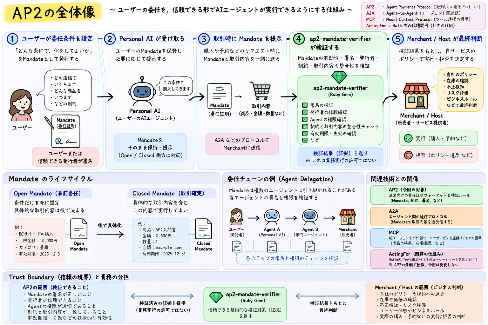
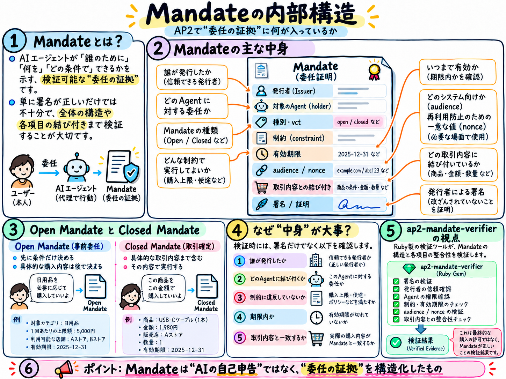
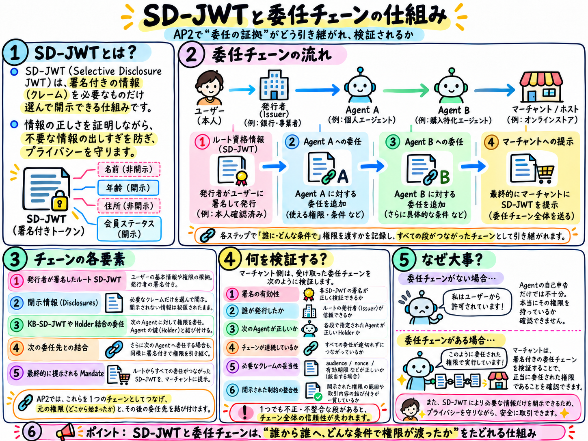
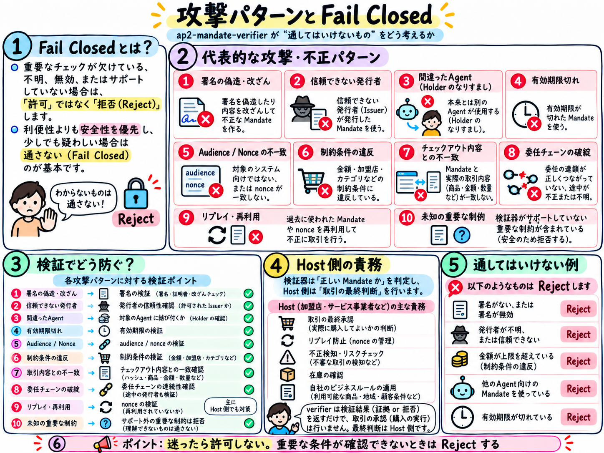

# AP2 Mandate Verifier — 0.1.0

[Japanese / 日本語](README.ja.md)

A Rails-independent Ruby Gem for a deliberately fixed AP2 verification profile. **A valid signature alone never authorizes a purchase.** Successful checks produce immutable Evidence; the Host makes the final business decision.

## Start with the local demo

The [AP2 Mandate Verifier Demo](https://github.com/cuichangquan/ap2-mandate-verifier-demo) calls the real verifier on synthetic valid, tampered and expired examples, with Docker local-startup instructions; it is not a hosted demo site, production payments or Host authorization.

For Ruby-only usage, follow the [saved synthetic example](#try-the-saved-synthetic-example); see the [supported contract](#supported-contract) for the exact scope.

## Distribution and installation

[0.1.0 is published on RubyGems](https://rubygems.org/gems/ap2_mandate_verifier/versions/0.1.0). This is the fixed-profile, verifier-only stable release; the research prerelease pre3 is a separate artifact.

Use an existing MRI 4.0.9 environment and your chosen Gem isolation. Normal installation may fetch dependencies and build JSON native extensions. Stop on conflicts or unknown providers rather than relaxing pins.

```sh
ruby --version # MRI 4.0.9 required
gem install ap2_mandate_verifier --version 0.1.0
```

Bundler Gemfile:

```ruby
gem "ap2_mandate_verifier", "= 0.1.0"
```

Fixed runtime dependencies: JSON 2.19.9, JWT 3.3.0, base64 0.3.0, OpenSSL gem 4.0.2 and Digest 3.2.1.
Bundler 4.0.20 is the observed resolver baseline, not a runtime dependency. Gem version constraints alone do not enforce the MRI engine, OS or native-provider provenance.

## Supported contract

- AP2 pinned source `b4587ac1d055888a73b4b21750973cffba961793`, registered profile `ap2.checkout.single_merchant_sku` v1: exact body/hash and seven supported shapes.

- ES256/P256, Open1→Closed1, three fixed disclosure positions, one Merchant/SKU/line, USD/EUR/JPY and empty links; unknown/unsupported forms are rejected.

- The Gem checks strict bounded inputs, supplied trust selection, signed Root wire and full supported closure, Agent/Merchant signatures, delegation, purchase/Host binding, types, constraints and time.

- The existing `verify_research` entry, `verified_research` / `scoped_research_verified` result names and Evidence v2 contract remain unchanged; a stable version does not imply generic AP2 support or Host authorization.

See [SUPPORT_CONTRACT](docs/SUPPORT_CONTRACT.md) for exact required shapes, bounds and failure codes.

## Environment, compatibility and maintenance

The baseline is MRI 4.0.9 with fixed dependencies and the exact observed MBA/macOS arm64 and Ubuntu 24.04/x86_64 configurations. Distinguish [release-package/provider evidence](research/stable010_release_linux_package/README.md) from [historical environment records](docs/VERIFIER_CORE_COMPLETION_CRITERIA.md#初回の対応環境保証範囲owner採用済み). Other OS versions, engines, architectures and arbitrary provider updates are not covered.

Supported-input semantics and APIs do not change silently. Security-driven narrowing identifies reason, impact and migration; breaking API/required-field/profile changes are explicit. Dependency updates are not automatically compatible.

Maintenance covers the latest patch in the initial stable series, with manual monthly/advisory/pre-release review. No old-series backport, fixed support term, response/fix deadline or 24/7 promise. See [SECURITY](SECURITY.md) and [maintenance](docs/POST_RELEASE_MAINTENANCE.md); never report private keys, real Mandates or personal data.

## Try the saved synthetic example

This example reads the same public `FULL` input used by the successful installed-Gem checks. The input JSON is not packaged in the Gem. Fetch it from the pinned commit and verify its SHA256 first. It contains no private keys. Its trust/Host assertions are **synthetic test data**, not real Issuer enrollment, a current order or a live clock. `verified_at = 1800000000` is the saved scenario's fixed evaluation time.

```sh
set -eu
curl --fail --location --proto '=https' --proto-redir '=https' \
  --output AP2_RESEARCH_INPUTS.json \
  https://raw.githubusercontent.com/cuichangquan/ap2-mandate-verifier/f6d4f83d396b75505256dba5769a54a8f065eeea/research/stage15/results/R3/INPUTS.json
printf '%s\n' '41ad845a7ea82a9c7316c9ef11fb8ee5281453afafe2b4932c7217c1936562c1  AP2_RESEARCH_INPUTS.json' | shasum -a 256 -c -
# Save the Ruby example below as research_example.rb, then:
ruby research_example.rb
```

```ruby
require "ap2_mandate_verifier"
require "json"
require "digest"

raw = File.binread("AP2_RESEARCH_INPUTS.json")
expected = "41ad845a7ea82a9c7316c9ef11fb8ee5281453afafe2b4932c7217c1936562c1"
raise "fixture checksum mismatch" unless Digest::SHA256.hexdigest(raw) == expected

full = JSON.parse(raw).fetch("FULL")
inputs = {
  trust_json: full.fetch("trust_json"),
  selection_json: full.fetch("selection_json"),
  host_json: full.fetch("host_json"),
  root_presentation: full.fetch("root_presentation"),
  terminal_jws: full.fetch("terminal_jws"),
  host_checkout_jws: full.fetch("host_checkout_jws"),
  verified_at: full.fetch("verified_at")
}

result = AP2MandateVerifier.verify_research(**inputs)
puts "status=#{result.status} code=#{result.code}"
if result.success?
  checked_facts = result.evidence.to_h # Detached, deeply frozen in-process facts.
  puts "Scoped verification succeeded; this is NOT purchase authorization."
  # No payment, order update or nonce consumption is performed here.
else
  raise "Verification did not succeed; stop."
end
```

For this saved `FULL` case, the expected result is `status=:verified_research`, `code=:scoped_research_verified`, `success?=true`. This is not the expected outcome for arbitrary real inputs, unsupported forms or dependency failures. Non-success results have nil Evidence. Exceptions or process termination without a result must also stop the caller. Avoid logging complete Evidence or raw inputs.

## Real inputs and responsibility boundaries

| Keyword | Input contract |
| --- | --- |
| `trust_json` | Original JSON String for authenticated Host trust snapshot, profile and public-key registration. |
| `selection_json` | Independently selected tenant, profile version and role/identity/purpose/key references. |
| `host_json` | Authenticated current order binding, issued challenge, expected issuer and clock identity. |
| `root_presentation` | Original signed Root presentation String, preserving disclosure order and trailing `~`. |
| `terminal_jws` | Original Agent terminal compact JWS String. |
| `host_checkout_jws` | Original Merchant Checkout compact JWT String frozen by the Host. |
| `verified_at` | Integer Unix seconds supplied by an external trusted clock. |

See [SUPPORT_CONTRACT](docs/SUPPORT_CONTRACT.md#full-entry-and-required-inputs) for exact required shapes, types and limits. Do not register trust from the presented token or parse/re-encode/reorder signed wire input. Matching Host-only Buyer/account fields does not establish Issuer-signed identity authentication.

A successful `verify_research` result establishes scoped verification facts. The Host still must recheck latest trust/revocation/order version/challenge/time and atomically consume the nonce with order CAS. The Gem does not perform those operations. Serializing Evidence to JSON does not preserve or reconstruct authenticity through this API. Legacy `verify(presentation_json:)` checks only the JSON syntax boundary and never returns successful Evidence.

Before integration, consult the [Issuer onboarding checklist](docs/ISSUER_ONBOARDING_CHECKLIST.md) and [Issuer/Host minimum contract](docs/ISSUER_HOST_MINIMUM_CONTRACT.md). Real-Issuer trust and a specific Host's production GO are not established by this Gem version or verification success. The contract and Host/DB code under `research/` describe synthetic research designs and limited observations, not a production adapter.

Raw nonce values are input-only; Evidence projects their SHA256. Other low-level verification entries also keep `success?=false` and `evidence=nil`; do not apply the successful example to those entries.

## Exclusions and safe stopping

General AP2/full Schema, arbitrary real-Issuer interoperability, issuance/presentation/Receipt generation, Rails adapters, real payments/Host/DB/revocation operations, worst CPU/RSS/concurrency and numerical SLAs are outside scope. No defect-free/all-path safety proof is claimed; exclusions do not excuse known major defects or missing Gem checks.

The Host supplies authenticated token-independent trust/keys/profile and current revocation/clock/order/challenge state, rechecks before use, atomically consumes nonce with order CAS, reconciles PENDING and decides ALLOW. Existing Gem checks remain Gem responsibilities. Evidence is in-process checked facts in trusted Ruby, not a transport credential. Unknown/rejected/unavailable/exception/missing results never authorize; the Host provides outer time/memory/concurrency limits.

## Evidence and history

The published archive is **34,304 bytes**, SHA256 `37b2a235b6fab2d9d9765ae985dd9db27afd3b2c5407fe263a6b65314550db32`. Official metadata, owner `cuichangquan`, downloaded distribution bytes and all 13 payload hashes were checked on 2026-10-26. See the [publication record](research/stable010_release_linux_package/README.md#rubygems-publication-verified). This repository README was reorganized after publication and differs from the packaged README; the published archive was not rebuilt.

See the [versioned validation record](research/stable010_release_linux_package/README.md) for this archive's external SHA, per-environment observations and limits. The archive hash is kept outside its payload to avoid self-reference. A hash identifies bytes, not Host trust or global safety.

[Earlier 0.1.0 candidate R1](research/stable010_candidate/README.md), [published pre3](https://rubygems.org/gems/ap2_mandate_verifier/versions/0.1.0.pre.3) and [pre2 Release](https://github.com/cuichangquan/ap2-mandate-verifier/releases/tag/v0.1.0.pre.2) are different archives. Historical NOT_RUN/stops/passes remain tied to their original bytes and time. Reusing 885 regressions (including 147) and Ruby4.0.1 independent comparisons is not a fresh 885 run or Linux independent Oracle.

[Historical research documentation](https://github.com/cuichangquan/ap2-mandate-verifier/blob/2546d112b4bd4eaaf0a55b502f1c40b1fd61be65/README.md#research-documentation) does not override the current contract or release status. Future SDK plans are described in [PRODUCT_VISION](docs/PRODUCT_VISION.md).

## Illustrated concepts (Japanese diagrams)

These existing diagrams contain Japanese text and illustrate broader AP2 concepts, not the exact 0.1.0 implementation contract. The fixed-profile contract above takes precedence. Issuer trust and current revocation are supplied and maintained by the Host; the Gem does not independently establish live external trust or revocation. Arbitrary chains, issuance, Payment Mandates and payment execution shown conceptually are not supported features of this release.

### AP2 overview (Japanese)


### Delegation and Host responsibility boundaries (Japanese)



### Mandate anatomy (Japanese)



### SD-JWT and delegation concepts (Japanese)



### Fail-closed attack patterns and Host replay prevention (Japanese)



## License

MIT. See [LICENSE](LICENSE).
